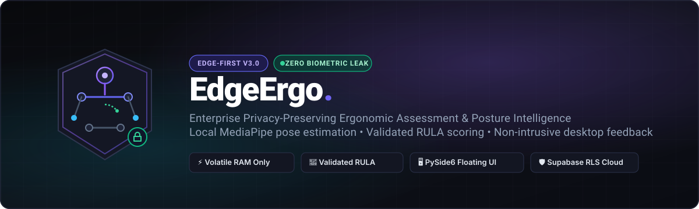
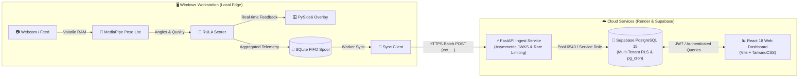

<div align="center">



# EdgeErgo V3

**Privacy-Preserving Workplace Ergonomic Assessment &amp; Posture Intelligence**

An enterprise-grade, edge-first ergonomics platform that estimates workstation posture locally via computer vision, computes validated upper-body screening indicators, and provides real-time, non-punitive desktop feedback without ever storing or transmitting biometric data.

[](https://python.org)
[](https://fastapi.tiangolo.com)
[](https://react.dev)
[](https://www.typescriptlang.org)
[](https://vitejs.dev)
[](https://supabase.com)
[](https://microsoft.com/windows)
[](#-privacy-boundary-guarantee)

---

### [✨ Key Features](#-key-features) • [🔒 Privacy Boundary](#-privacy-boundary-guarantee) • [📐 Architecture](#-system-architecture) • [🚀 Quick Start](#-quick-start) • [📋 Project Layout](#-repository-layout) • [📖 Documentation](#-documentation-index)

---

</div>

<br/>

## 🌟 Key Features

<table>
  <tr>
    <td width="50%" valign="top">
      <h3>🧠 On-Device Vision Intelligence</h3>
      <ul>
        <li><b>MediaPipe Pose Estimation:</b> 33 skeletal landmarks computed directly on the local CPU in volatile RAM.</li>
        <li><b>Zero Video Persistence:</b> Webcam frames are analyzed in memory and instantly overwritten. Zero video files, frame snapshots, or face crops ever touch disk or network.</li>
      </ul>
    </td>
    <td width="50%" valign="top">
      <h3>📐 Validated RULA Ergonomics</h3>
      <ul>
        <li><b>Biomechanical Screening:</b> Validated Rapid Upper Limb Assessment (McAtamney &amp; Corlett, 1993) adapted for standard office workstations.</li>
        <li><b>Temporal Smoothing &amp; Hysteresis:</b> Eliminates alert fatigue by requiring sustained posture trends before triggering guidance.</li>
      </ul>
    </td>
  </tr>
  <tr>
    <td width="50%" valign="top">
      <h3>🖥️ Focus-Free Desktop Coaching</h3>
      <ul>
        <li><b>PySide6 Floating Overlay:</b> Minimalist, dark charcoal desktop widget with subtle posture indicators and gentle habit nudges.</li>
        <li><b>Zero Focus Interruption:</b> Operates with <code>WindowDoesNotAcceptFocus</code> to prevent disrupting active workflows or typing.</li>
      </ul>
    </td>
    <td width="50%" valign="top">
      <h3>📊 Multi-Tenant Cloud Dashboard</h3>
      <ul>
        <li><b>Enterprise Postgres &amp; RLS:</b> Strict tenant isolation enforced at the database layer via Supabase Row-Level Security.</li>
        <li><b>Actionable Ergonomic Analytics:</b> Non-interpolated time-series trends, workstation fleet status, and audit-ready sanitized exports.</li>
      </ul>
    </td>
  </tr>
</table>

<br/>

---

## 🔒 Privacy Boundary Guarantee

> [!IMPORTANT]
> **Strict Non-Diagnostic &amp; Non-Punitive Notice**  
> EdgeErgo is an ergonomic habit coach and screening indicator. It is **not** a clinical diagnostic medical device and **must never** be used for employee surveillance, performance grading, or workplace ranking.

```
       WORKSTATION LOCAL PRIVACY BOUNDARY (VOLATILE RAM)
  [Webcam Stream] ──> [MediaPipe Pose] ──> [Feature Extraction] 
                                                    │
             ❌ DISCARDED IMMEDIATELY:              ▼
             - Raw video & image frames    [RULA Scorer] ──> [Local Floating Overlay]
             - Facial crops & identity              │
             - Raw (X, Y, Z) coordinates            │ (Allowlisted Aggregated Telemetry Only)
  ──────────────────────────────────────────────────┼───────────────────────────────────────
                    CLOUD SYNC BOUNDARY             ▼
                                           [HTTPS Batch Ingest]
```

### Data Handling Matrix

| Data Category | Handled In | Persisted to Disk? | Transmitted to Cloud? |
|---|:---:|:---:|:---:|
| **Raw Video Frames / Image Feeds** | Volatile RAM only | ❌ **Never** | ❌ **Never** |
| **Facial Imagery & Biometrics** | Volatile RAM only | ❌ **Never** | ❌ **Never** |
| **Raw 33-Point Skeleton Coordinates** | Volatile RAM only | ❌ **Never** | ❌ **Never** |
| **Device Secrets (Auth Tokens)** | Windows Credential Manager | ✅ Encrypted (DPAPI) | ❌ **Never** |
| **Aggregated Ergonomic Indicators** *(Score, Duration, Validity)* | SQLite FIFO Spool | ✅ Encrypted / Local | ✅ HTTPS Batch Sync |

<br/>

---

## 📐 System Architecture

### End-to-End Component Flow



<br/>

---

## 💻 System Requirements & Prerequisites

| Component | Minimum Requirements | Verified Environments |
|---|---|---|
| **Python** | Python `3.10.x` (64-bit AMD64) | Python `3.10.11` |
| **Node.js & npm** | Node.js `>= 18.x`, npm `>= 9.x` | Node.js `v22.23.2`, npm `10.9.8` |
| **Desktop OS** | **Windows 10 / 11 (64-bit)** for Edge Agent | Windows 11 Enterprise / Pro (x64) |
| **Server & Web OS** | **Linux, macOS, or Windows** for API & Dashboard | Ubuntu 22.04 LTS, macOS Sonoma, Windows 11 |
| **Webcam Hardware** | Standard USB or integrated 720p/1080p camera | DirectShow compatible (30 FPS) |

<br/>

---

## 📁 Repository Layout

```
edge-ergo-v3/
├── 📂 backend/               # FastAPI backend service (Render Web Service)
│   ├── app/                 # Core API, database models, schemas, and services
│   ├── tests/               # Pytest test suite (auth, devices, telemetry, RLS)
│   ├── pyproject.toml       # Pinned backend dependencies
│   └── requirements.txt     # Production container dependencies
├── 📂 edge-agent/            # Windows desktop edge agent
│   ├── edge_ergo/           # Vision pipeline, RULA scoring, overlay, sync spool
│   ├── tests/               # Comprehensive unit and integration test suite
│   ├── edge-ergo.spec       # PyInstaller standalone binary packaging spec
│   └── pyproject.toml       # Pinned agent dependencies
├── 📂 frontend/              # Analytics web dashboard (Render Static Site)
│   ├── src/                 # React 18 source (components, pages, lib, features)
│   ├── package.json         # Pinned frontend dependencies
│   ├── vite.config.ts       # Vite & Vitest configuration
│   └── tailwind.config.ts   # Charcoal & violet design system tokens
├── 📂 supabase/              # Database schema migrations & seeds
│   ├── migrations/          # Canonical SQL migrations (RLS, functions, pg_cron)
│   └── seed.sql             # Base organization seed fixtures
├── 📂 docs/                  # Authoritative architectural documentation & runbooks
│   ├── MANUAL_RUNBOOK.md    # Master step-by-step operator runbook (Groups A–H)
│   ├── SCORING_METHOD.md    # Validated RULA upper-body screening methodology
│   └── PRIVACY.md           # Workplace privacy disclosure & employee notice
├── 📂 scripts/               # Developer runners, benchmark, and security tooling
│   ├── dev.ps1 / dev.sh     # Unified verification runners
│   ├── check_secrets.py     # Zero-tolerance secret pattern scanner
│   └── build_agent.ps1      # Windows PyInstaller packaging automation
└── render.yaml              # Render Infrastructure-as-Code Blueprint
```

<br/>

---

## 🚀 Quick Start

Follow these steps to run all three components in local development mode.

### 1️⃣ Clone & Initialize

```powershell
# Clone the repository
git clone https://github.com/georgybenoy/edge-ergo-v3.git
cd edge-ergo-v3

# Verify installed prerequisites
python --version   # Must be Python 3.10.x
node --version     # Must be >= 18.x
```

---

### 2️⃣ Component 1 — Hosted REST API (FastAPI)

```powershell
# Navigate to backend directory
cd backend

# Create local environment file
Copy-Item .env.example .env

# Install backend dependencies
pip install -e ".[dev]"

# Launch the development server
python -m uvicorn app.main:app --host 0.0.0.0 --port 8000 --reload
```

> **Verification:** Query readiness at `http://localhost:8000/health/ready`.  
> Interactive OpenAPI documentation is available at [http://localhost:8000/docs](http://localhost:8000/docs).

---

### 3️⃣ Component 2 — Web Dashboard (React + Vite)

Open a new terminal session:

```powershell
# Navigate to frontend directory
cd frontend

# Create local environment file
Copy-Item .env.example .env

# Install dependencies and start Vite
npm install
npm run dev -- --port 5173
```

> **Access Dashboard:** Open [http://localhost:5173](http://localhost:5173) in your browser.  
> *In development mode, a persistent **"DEVELOPMENT FIXTURE DATA"** banner enables full exploration of all charts, filters, device tables, and reports without cloud credentials.*

---

### 4️⃣ Component 3 — Windows Desktop Edge Agent

Open a new terminal session:

```powershell
# Navigate to edge-agent directory
cd edge-agent

# Install agent dependencies
pip install -e ".[dev]"

# 1. Run the offline self-test (validates OpenCV, MediaPipe, NumPy, PySide6)
python -m edge_ergo.main --selftest

# 2. Run simulation mode (No webcam required; launches floating overlay)
python -m edge_ergo.main --fake-camera --dry-run

# 3. Run live webcam posture tracking
python -m edge_ergo.main
```

> **Device Enrollment:**  
> On the web dashboard at `http://localhost:5173/devices`, click **Enroll New Device** and copy the generated token (`eet_...`).  
> ```powershell
> python -m edge_ergo.main enroll --api http://127.0.0.1:8000 --token <ENROLLMENT_TOKEN>
> ```
> The device secret is stored securely in **Windows Credential Manager** (DPAPI).

---

### 5️⃣ Standalone Windows Packaging (PyInstaller)

To package the agent into a single distribution that requires no installed Python runtime:

```powershell
powershell -ExecutionPolicy Bypass -File scripts/build_agent.ps1
```
The executable is generated at `edge-agent/dist/edge-ergo/edge-ergo.exe`.

<br/>

---

## 🛠️ Unified Quality Gate & Developer Runner

Execute linting, type-checking, secret scanning, and full test suites with a single command:

```powershell
# Run the complete test suite across all 3 stacks
.\scripts\dev.ps1 all

# Or run individual verification stages:
.\scripts\dev.ps1 check-secrets  # Zero-tolerance secret pattern scan
.\scripts\dev.ps1 lint           # Ruff (Python) & ESLint (TypeScript)
.\scripts\dev.ps1 typecheck      # Mypy & TypeScript project compiler (tsc -b)
.\scripts\dev.ps1 test           # Pytest (Backend + Agent) & Vitest (Frontend)
.\scripts\dev.ps1 build          # Production frontend build
```

*(On Linux / macOS systems, use `./scripts/dev.sh all`)*

<br/>

---

## 📋 Verification Status & Transparency

In accordance with PRD §12 and DESIGN §17, EdgeErgo maintains strict transparency regarding verified capabilities versus pending manual reviews:

| Item | Requirement | Verification Status | Action Runbook |
|---|---|---|:---:|
| **PRD §12 #16** | **Live Render Production Deployment** | ⏳ **Pending Cloud Operator Linking**<br>Blueprint (`render.yaml`) and local production container test pass 12/12 checks. Live cloud provisioning requires connecting the repository in the Render dashboard. | [Runbook Group D](docs/MANUAL_RUNBOOK.md#group-d-render-cloud-deployment) |
| **PRD §12 #18** | **Clean-Machine Windows VM Test** | ⏳ **Pending Pilot Cohort Rollout**<br>PyInstaller executable builds cleanly and passes `--selftest`. Fresh OS testing on a non-developer Windows 10/11 laptop is scheduled for pilot deployment. | [Runbook Group E](docs/MANUAL_RUNBOOK.md#group-e-windows-agent-packaging--clean-machine-test) |
| **PRD §12 #19** | **Physical Hardware Benchmarks** | ⏳ **Pending Workstation Measurement**<br>Profiler script (`scripts/benchmark_edge.py`) verified. Latency (p50/p95) and RAM usage are reserved for physical measurement on pilot participant machines. | [Runbook Group G](docs/MANUAL_RUNBOOK.md#group-g-performance--hardware-measurements) |
| **PRD §12 #8** | **Clinical Ergonomist Sign-Off** | ⏳ **Pending Pre-Pilot Formal Review**<br>Scientific documentation complete in [docs/SCORING_METHOD.md](docs/SCORING_METHOD.md). Formal written review from a Certified Professional Ergonomist (CPE) precedes active employee tracking. | [Runbook Group H](docs/MANUAL_RUNBOOK.md#group-h-clinical--legal-reviews) |

<br/>

---

## 📖 Documentation Index

| Guide / Specification | Description |
|---|---|
| 📘 **[docs/MANUAL_RUNBOOK.md](docs/MANUAL_RUNBOOK.md)** | Master operational runbook covering setup, deployment, testing, and audits (Groups A–H). |
| 📐 **[docs/SCORING_METHOD.md](docs/SCORING_METHOD.md)** | Validated RULA upper-body ergonomic screening algorithms, angle thresholds, and lookup tables. |
| 🔒 **[docs/PRIVACY.md](docs/PRIVACY.md)** | Technical privacy architecture, employee privacy notice, and biometric boundary disclosures. |
| 🛡️ **[docs/SECURITY.md](docs/SECURITY.md)** | Zero-trust threat model, credential management, cryptographic tokens, and fail-closed policies. |
| 🗄️ **[docs/DATABASE.md](docs/DATABASE.md)** | Supabase PostgreSQL schema, Row-Level Security policies, and pg_cron retention schedules. |
| 🔄 **[docs/SYNC_PROTOCOL.md](docs/SYNC_PROTOCOL.md)** | Workstation offline spooling, SQLite FIFO queue, idempotency keys, and sync worker protocol. |
| 🌐 **[docs/API.md](docs/API.md)** | Complete REST API contract, request/response schemas, and JWT authentication workflows. |
| ⚖️ **[docs/AUTHZ_MATRIX.md](docs/AUTHZ_MATRIX.md)** | Multi-tenant role permissions matrix (Anonymous, Enrolled Device, Viewer, Admin). |
| ⚠️ **[docs/LIMITATIONS.md](docs/LIMITATIONS.md)** | Optical and physical boundaries of 2D monocular webcam posture screening. |
| 🛠️ **[docs/TROUBLESHOOTING.md](docs/TROUBLESHOOTING.md)** | Systematic diagnostic workflows for webcam initialization, network spooling, and token errors. |
| 🏗️ **[docs/DECISIONS.md](docs/DECISIONS.md)** | Architectural Decision Records (ADRs) documenting design rationale. |

<br/>

---

<div align="center">

**EdgeErgo Platform** • Built with privacy, accuracy, and ergonomic science.

[⬆ Back to top](#edgeergo-v3)

</div>
