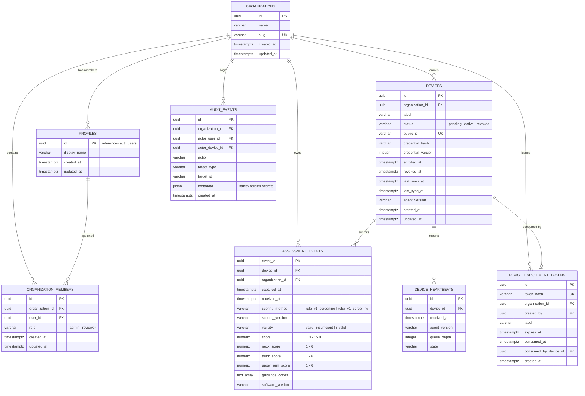

# EdgeErgo V3 — Database Architecture & Schema Specification

This document details the PostgreSQL and Supabase database design, entity relationships, security models, Row Level Security (RLS) policies, retention policies, migration workflows, and privacy column allowlists for EdgeErgo V3.

---

## 1. Entity Relationship (ER) Overview

EdgeErgo V3 employs a multi-tenant schema with tenant isolation anchored on `organizations.id`. All foreign keys reference primary keys (UUIDs), with UTC timestamps (`timestamptz`), strict check constraints, and composite unique keys ensuring idempotent telemetry ingestion.



---

## 2. Table Catalog & Descriptions

| Table Name | Purpose | Primary Key | Key Constraints & Uniqueness |
| :--- | :--- | :--- | :--- |
| `organizations` | Tenant partition root. All tenant assets belong to an organization. | `id` (UUID) | Unique `slug`. |
| `profiles` | Mirrors Supabase `auth.users`, storing non-auth display names and metadata. | `id` (UUID = `auth.users.id`) | Foreign key on delete cascade to `auth.users`. Populated via trigger. |
| `organization_members` | Maps users to organizations and assigns membership roles. | `id` (UUID) | Unique composite `(organization_id, user_id)`. Role check: `('admin', 'reviewer')`. |
| `devices` | Enrolled workplace workstations running the edge agent. Never stores plaintext secrets. | `id` (UUID) | Unique `public_id`. Status check: `('pending', 'active', 'revoked')`. |
| `device_enrollment_tokens` | Single-use registration tokens generated by organization admins to enroll new devices. | `id` (UUID) | Unique `token_hash` (SHA-256). Expiration and consumption tracking. |
| `assessment_events` | Anonymized ergonomic screening metrics computed on edge devices. | `event_id` (UUID) | Unique `(device_id, event_id)` for idempotent ingestion. Validity and numeric range checks. |
| `device_heartbeats` | Real-time health, connectivity, and telemetry queue metrics sent by devices. | `id` (UUID) | Foreign key to `devices.id`. Non-negative `queue_depth`. |
| `audit_events` | Immutable security audit log tracking administrative, device, and policy actions. | `id` (UUID) | Check constraint rejecting sensitive keys (`password`, `secret`, `token`, `key`, `credential`) in `metadata`. |

---

## 3. Backend Connection Strategy & Least-Privilege Role

### Why `edgeergo_api`?
FastAPI backend services execute operations on behalf of edge devices (ingesting assessments, recording heartbeats, verifying tokens) and manage organizational configurations. 

Connecting to PostgreSQL as the `postgres` superuser or using the Supabase `service_role` directly bypasses database security boundaries and exposes schema internals. Conversely, connecting as an unauthenticated or generic client is subject to client RLS restrictions designed for frontend users.

EdgeErgo V3 defines a dedicated PostgreSQL role: **`edgeergo_api`**:
- **NOLOGIN in Migrations:** The role is provisioned via migration scripts without hardcoded credentials. A strong login password is assigned manually or via secure secret management (see [MANUAL_TASKS.md](file:///c:/Users/georg/Edge-Ergo%20V5/MANUAL_TASKS.md)).
- **DML Only:** Granted `USAGE` on schema `public` and `SELECT, INSERT, UPDATE, DELETE` on application tables.
- **No DDL Privileges:** Cannot create, alter, or drop tables, schemas, or functions.
- **No Auth Schema Access:** Strictly forbidden from accessing `auth.users` passwords, salt hashes, or refresh tokens.
- **Forced RLS Exemption:** Granted `BYPASSRLS` to allow trusted backend services to ingest device telemetry across organizations after authenticating HMAC device credentials in application code.

### Connection Configuration
The backend connects via standard PostgreSQL pooled connection strings:
```
DATABASE_URL=postgresql://edgeergo_api:<SECURE_PASSWORD>@<DB_HOST>:<DB_PORT>/<DB_NAME>?sslmode=require
```

---

## 4. Row Level Security (RLS) Policy Matrix

Row Level Security is enabled and **FORCED** on all public tables. The policy matrix below summarizes access permissions across roles:

| Table | Role: `anon` | Role: `authenticated` (Admin) | Role: `authenticated` (Reviewer) | Role: `edgeergo_api` / `service_role` |
| :--- | :--- | :--- | :--- | :--- |
| `organizations` | Denied | `SELECT` own org | `SELECT` own org | Full Access |
| `profiles` | Denied | `SELECT` all; `UPDATE` own | `SELECT` all; `UPDATE` own | Full Access |
| `organization_members` | Denied | `SELECT` own org members | `SELECT` own org members | Full Access (Writes managed by backend) |
| `devices` | Denied | `SELECT` own org devices | `SELECT` own org (via `devices_public` only) | Full Access |
| `device_enrollment_tokens` | Denied | `SELECT` own org tokens | Denied | Full Access |
| `assessment_events` | Denied | `SELECT` own org assessments | `SELECT` own org assessments | Full Access (Ingestion via backend) |
| `device_heartbeats` | Denied | `SELECT` own org heartbeats | `SELECT` own org heartbeats | Full Access |
| `audit_events` | Denied | `SELECT` own org audit log | Denied | Full Access (Audit logger in backend) |

### Reviewer Credential Protection & Safe Views
To guarantee that reviewers and dashboard users can never inspect device authentication hashes:
1. Column-level permissions on `devices`: `REVOKE SELECT (credential_hash) ON public.devices FROM authenticated;`.
2. Safe View: `public.devices_public` provides a secure view omitting `credential_hash`.
3. Client Writes Prohibited: Standard clients (`authenticated`, `anon`) have **zero** INSERT, UPDATE, or DELETE grants on `organization_members`, `devices`, `device_enrollment_tokens`, `assessment_events`, `device_heartbeats`, or `audit_events`. All data mutations must flow through verified backend APIs.

---

## 5. Security Functions & Helpers

The following helper functions are declared with `SECURITY DEFINER` and fixed `search_path = public, pg_temp` to prevent search-path injection vulnerabilities:

1. **`is_org_member(p_org_id uuid) -> boolean`**: Checks if `auth.uid()` belongs to the specified organization.
2. **`org_role(p_org_id uuid) -> varchar`**: Returns the role (`admin` or `reviewer`) of `auth.uid()` in the specified organization.
3. **`handle_new_user() -> trigger`**: Automatically inserts a matching row into `public.profiles` when a new record is added to `auth.users`.
4. **`purge_expired_records(assessment_days, heartbeat_days, audit_days)`**: Deletes records exceeding retention thresholds.

---

## 6. Retention Windows & Purge Policy

Per [DECISIONS.md #8](file:///c:/Users/georg/Edge-Ergo%20V5/docs/DECISIONS.md#decision-8-data-retention-windows):

| Data Category | Target Table | Retention Window | Purge Criteria |
| :--- | :--- | :--- | :--- |
| **Ergonomic Assessments** | `assessment_events` | 365 Days | `captured_at < NOW() - INTERVAL '365 days'` |
| **Device Heartbeats** | `device_heartbeats` | 30 Days | `received_at < NOW() - INTERVAL '30 days'` |
| **Security Audit Logs** | `audit_events` | 365 Days | `created_at < NOW() - INTERVAL '365 days'` |
| **Enrollment Tokens** | `device_enrollment_tokens` | Immediate upon use or 48h | Managed upon consumption or expiration |

### Purge Execution
Retention is executed via the stored SQL function:
```sql
SELECT * FROM public.purge_expired_records(
    p_assessment_days := 365,
    p_heartbeat_days := 30,
    p_audit_days := 365
);
```
Automatic invocation is scheduled via `pg_cron` or external task runners (see [MANUAL_TASKS.md](file:///c:/Users/georg/Edge-Ergo%20V5/MANUAL_TASKS.md)).

---

## 7. Database Migration Workflow

1. **Migration Files:** Ordered, timestamped SQL scripts stored in `supabase/migrations/`:
   - `YYYYMMDDHHMMSS_core_schema.sql`: Tables, primary keys, foreign keys, constraints, and indexes.
   - `YYYYMMDDHHMMSS_functions_rls.sql`: Helper functions, triggers, role grants, and RLS policies.
2. **Version Tracking:** Stored in `public.schema_migrations` (`version` text PK, `applied_at` timestamptz).
3. **Local Testing:** Executed against disposable PostgreSQL containers using `backend/app/db/migrations.py`.
4. **Production Deployment:** Applied using Supabase CLI:
   ```bash
   supabase link --project-ref <PROJECT_ID>
   supabase db push
   ```

---

## 8. Privacy Column Allowlist (PRD §9.5 Compliance)

EdgeErgo V3 enforces a strict **Zero Raw Biometric Storage** boundary. 

> [!CAUTION]
> The database schema strictly forbids any columns storing raw webcam frames, video files, image URLs, or raw landmark coordinate tuples `(x, y, z)`.

The **only** permitted per-event columns in `assessment_events` are:

| Field Name | Postgres Type | Valid Range / Format | Privacy Justification |
| :--- | :--- | :--- | :--- |
| `event_id` | `uuid` | RFC 4122 UUID | Unique event identifier generated at capture time. |
| `device_id` | `uuid` | References `devices.id` | Workstation attribution without personal identity. |
| `organization_id` | `uuid` | References `organizations.id` | Multi-tenant scoping. |
| `captured_at` | `timestamptz` | UTC Timestamp | Moment of observation at the edge. |
| `received_at` | `timestamptz` | UTC Timestamp | Ingestion timestamp for latency analysis. |
| `scoring_method` | `varchar` | `'rula_v1_screening'` \| `'reba_v1_screening'` | Scoring algorithm identifier. |
| `scoring_version` | `varchar` | SemVer string | Scoring model version. |
| `validity` | `varchar` | `'valid'` \| `'insufficient'` \| `'invalid'` | Quality flag indicating whether posture was assessable. |
| `score` | `numeric(4,1)` | 1.0 – 15.0 (RULA: 1.0–7.0) | Aggregate ergonomic risk score. |
| `neck_score` | `numeric(3,1)` | 1.0 – 6.0 | Sub-score for neck flexion/extension. |
| `trunk_score` | `numeric(3,1)` | 1.0 – 6.0 | Sub-score for trunk flexion/extension. |
| `upper_arm_score` | `numeric(3,1)` | 1.0 – 6.0 | Sub-score for upper arm elevation. |
| `guidance_codes` | `text[]` | Array of predefined strings | Context codes (e.g. `['FORWARD_HEAD', 'SLOUCH']`). |
| `software_version`| `varchar` | SemVer string | Edge agent version producing the score. |
