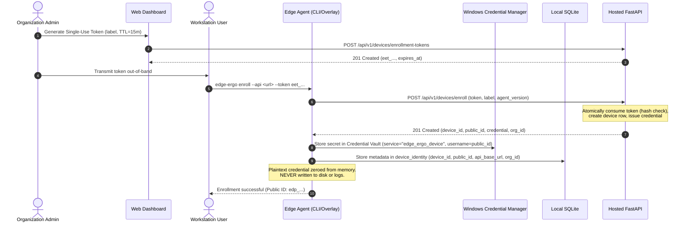
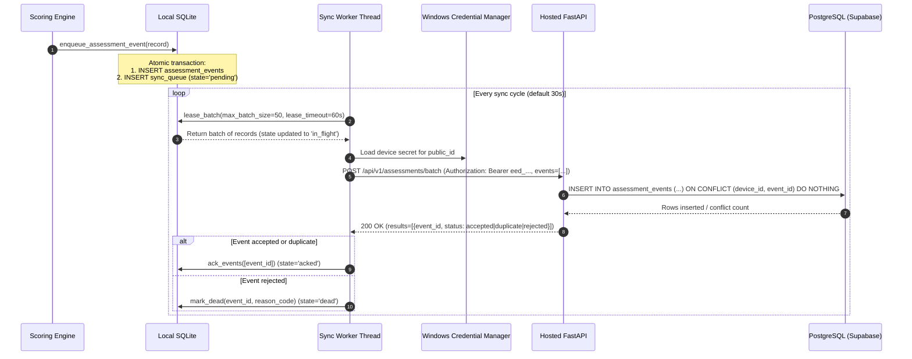
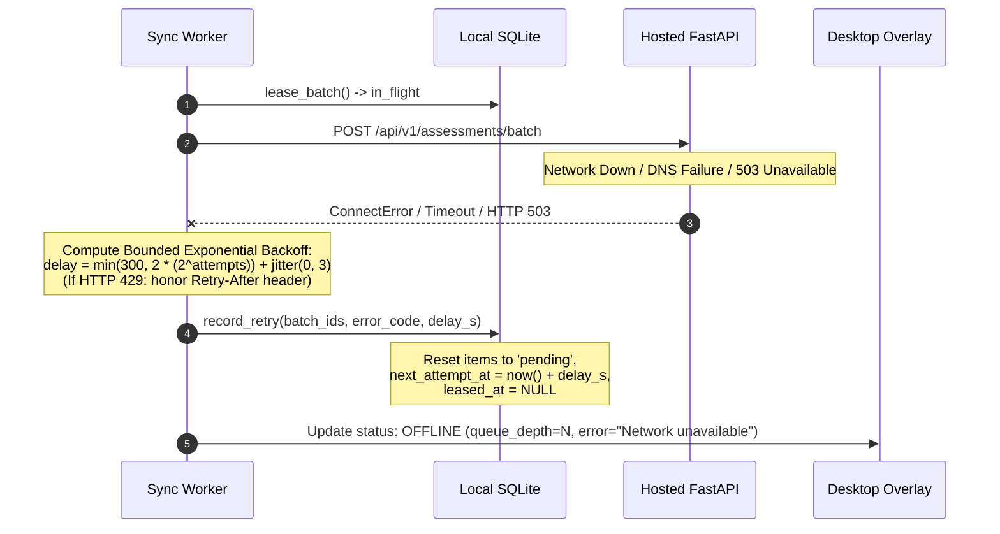
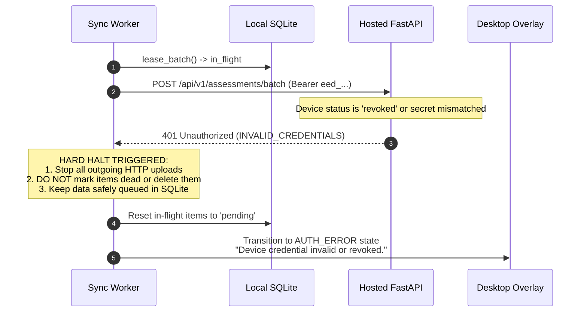

# EdgeErgo V3 — Offline Synchronization Protocol & State Machine

## 1. Overview & Architectural Guarantees

The EdgeErgo V3 synchronization subsystem provides resilient, crash-safe, and privacy-preserving telemetry transmission from on-device edge workstations to the hosted FastAPI / Supabase PostgreSQL backend.

### Core Guarantees:
1. **Zero Raw Media Exfiltration:** Telemetry payloads contain only aggregated, allowlisted posture metrics (RULA score, subscores, guidance codes, software version). Raw video frames, image buffers, and 33-point Cartesian landmark coordinates **never** enter the synchronization pipeline.
2. **Local Analysis Resiliency:** Workstation ergonomic evaluation continues completely uninterrupted during offline periods, network disconnections, server maintenance, or authentication lockout (FR-006).
3. **At-Least-Once Delivery with Server Idempotency:** Telemetry records are enqueued locally in SQLite before network transmission. Retries and retransmissions cannot create duplicates in PostgreSQL due to composite primary key uniqueness `(device_id, event_id)` and `ON CONFLICT DO NOTHING` ingestion.
4. **Explicit Acknowledgement Lifecycle:** Queue items are marked `acked` or pruned **only** after positive server confirmation (`status: "accepted"` or `status: "duplicate"`).
5. **Fail-Safe Credential Protection:** Device secrets (`eed_<public_id>.<secret>`) reside exclusively in Windows Credential Manager (via OS DPAPI / Credential Vault) and are never written to SQLite, configuration files, or logs.

---

## 2. State Machine

### 2.1 Sync Queue Item State Lifecycle

Every syncable observation progresses through a finite state machine inside local SQLite (`sync_queue` table):

```
                     [Event Recorded]
                            │
                            ▼
                     ┌──────────────┐
                     │   PENDING    │◄─────────────────┐
                     └──────┬───────┘                  │
                            │                          │
                 Lease batch│                          │ (Transient error,
                 for upload │                          │  backoff retry delay)
                            ▼                          │
                     ┌──────────────┐                  │
                     │  IN_FLIGHT   │──────────────────┤
                     └──────┬───────┘                  │
                            │                          │
               ┌────────────┴────────────┐             │
               │                         │             │
(Server confirms:          (Server confirms:           │
 "accepted" / "duplicate")  "rejected")                │
               │                         │             │
               ▼                         ▼             │
        ┌──────────────┐          ┌──────────────┐     │
        │    ACKED     │          │     DEAD     │     │
        └──────────────┘          └──────────────┘     │
        (Safe to prune)           (Permanent failure;  │
                                   never retried)      │
                                                       │
               [Worker Crash / Power Loss]             │
                            │                          │
                            ▼                          │
                     (Lease expired                    │
                      > 60 seconds)                    │
                            │                          │
                            └──────────────────────────┘
                              (Automatic Lease Recovery)
```

| State | Description | Next Action |
|---|---|---|
| `pending` | Observation stored; waiting for next attempt window (`next_attempt_at <= now()`). | Eligible to be leased by sync worker. |
| `in_flight` | Leased by sync worker for upload; protected by timestamp lease (`leased_at`). | Awaits HTTP response or lease timeout. |
| `acked` | Positive confirmation from server received (`accepted` or `duplicate`). | Permanently acknowledged; eligible for local retention pruning after 90 days. |
| `dead` | Permanent rejection by server (`rejected` with validation/schema failure). | Quarantined; error logged; never retried to prevent queue head-of-line blocking. |

---

## 3. Sequence Diagrams

### 3.1 Device Enrollment Handshake



### 3.2 Telemetry Ingestion Loop & Idempotency



### 3.3 Transient Network Failure & Bounded Backoff with Jitter



### 3.4 Hard Revocation & Authorization Failure (401 / 403)



---

## 4. Retry and Backoff Algorithm

Transient errors are handled using truncated exponential backoff with full jitter to avoid thundering-herd synchronization waves against the hosted API:

$$\text{Backoff}(a) = \min\left(T_{\max},\; T_{\text{base}} \times 2^{\min(a, a_{\max})}\right) + \text{random}(0, J)$$

Where:
- $T_{\text{base}} = 2.0\text{ seconds}$ (base delay)
- $T_{\max} = 300.0\text{ seconds}$ (maximum backoff ceiling: 5 minutes)
- $a_{\max} = 8$ (maximum exponent threshold)
- $J = 3.0\text{ seconds}$ (randomized uniform jitter)
- $a$ = consecutive attempt count for the batch.

### HTTP 429 Rate Limiting
When the server responds with `429 Too Many Requests` containing a `Retry-After: <seconds>` header, the worker parses the header integer and sets:
$$\text{delay} = \max(\text{Retry-After}, 5.0) + \text{random}(0, 2)$$
This explicitly respects backend rate limits.

---

## 5. Local Data Retention and Guarded Deletion

In accordance with PRD FR-034 and Decision 8:
- **Local Assessment History Window:** 90 days.
- **Guarded Purge Rule:** A periodic cleanup task runs every 24 hours executing:
  ```sql
  DELETE FROM assessment_events
  WHERE created_at < datetime('now', '-90 days')
    AND event_id NOT IN (
      SELECT event_id FROM sync_queue WHERE state != 'acked'
    );
  ```
- **Inviolable Invariant:** Unsynchronized observations (`state IN ('pending', 'in_flight')`) are **NEVER** purged regardless of age. If a workstation is offline for 6 months, its queued observations remain intact until connectivity is re-established.
